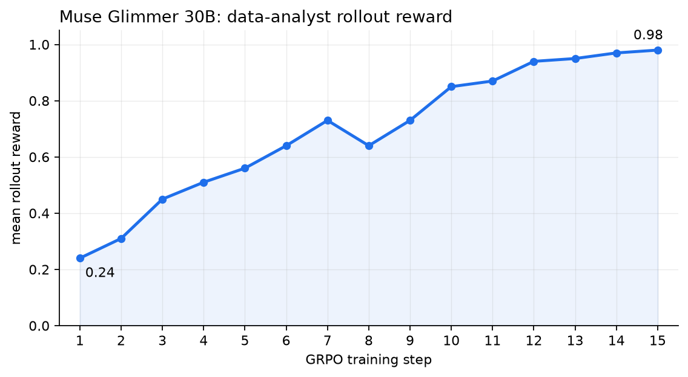
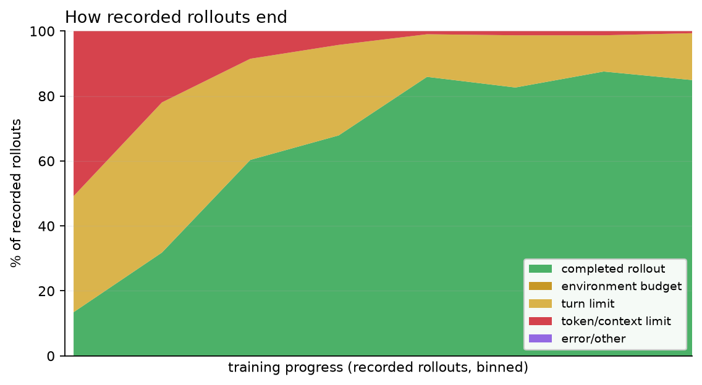

# Data Analyst: post-train Muse Glimmer with a verifiable reward

Teach Muse Glimmer to compute a number from a CSV or log file and write it to
`answer.json`. The reward is deterministic: no LLM judge, labelled dataset, or
external analysis service is needed.

| | |
|---|---|
| Precision | BF16, full-parameter training |
| Generator | TitanRL's in-process vLLM engine |
| Target hardware | One node with 8x H100 95GB GPUs |
| GPU split | Six trainer GPUs (FSDP=3, TP=2), two generator GPUs (TP=2) |
| Framework | [TorchTitan main](https://github.com/pytorch/torchtitan/tree/main/torchtitan/rl) |
| Offline? | Tasks are offline; setup downloads dependencies and weights. Use W&B offline mode after setup. |

The bash tool uses a private working directory and a stripped environment, not
full filesystem or container isolation. Use appropriately isolated training
infrastructure, without secrets or unrelated writable data available to
model-generated commands.

## Verification

Both the 10-update smoke and 15-update full demonstration completed on eight
H100 95GB GPUs, including final weight synchronization, held-out validation,
full-state checkpoint saving and a clean exit. A separate restart continued the
smoke's optimizer, scheduler and data loader from update 10 to 11. All 70 CPU
and helper tests passed without skips.

The full demonstration's 64 held-out synthetic tasks went from 26 correct before
training to 64 correct afterward. That is a small recipe-specific check, not a
claim of general analysis quality. W&B was enabled in offline mode. Exact source
and environment details and the separate failed long-budget run are recorded
in [`results/`](results/); recheck the workflow as upstream changes.





## Setup

### 1. Start from fresh clones and a named environment

Install [uv](https://docs.astral.sh/uv/getting-started/installation/) if needed.
From a directory where you keep checkouts:

```bash
git clone https://github.com/meta-models/meta-oss-cookbook.git
export COOKBOOK="$PWD/meta-oss-cookbook"
git clone https://github.com/pytorch/torchtitan.git
cd torchtitan

GLIMMER_ENV=glimmer-rl-data-analyst-smoke
uv venv --python 3.12 "$GLIMMER_ENV"
source "$GLIMMER_ENV/bin/activate"
```

Use a fresh environment name and repeat setup for a separate validation or
training run. If the cookbook is already cloned, set `COOKBOOK` to its absolute
path instead.

### 2. Install the current upstream RL stack

```bash
bash "$COOKBOOK/muse-glimmer/post-training/rl/titanrl/data-analyst/scripts/install_env.sh"
```

This small wrapper delegates to TorchTitan's current installer instead of
copying its package versions. It also carries the installed dataset package's
transitive requirements into the nightly resolve, preventing vLLM installation
from invalidating dataset dependencies. The upstream installer selects matching
Torch/torchvision/vLLM nightlies, TorchStore, batch-invariant ops, and the
attention build for your GPU. H100 uses FlashAttention-3.

The upstream installer deliberately removes TileLang even though vLLM's package
metadata declares it. TorchStore's declared Monarch version can also differ
from TorchTitan's runtime requirement: upstream installs TorchStore with
`--no-deps` to preserve its tested stack. These are known packaging mismatches,
not proof of a clean dependency check. Do not downgrade Monarch just to satisfy
stale metadata; run the CPU and GPU checks below for the exact source versions.
Other dependency conflicts should be investigated rather than ignored.

FlashInfer compiles kernels on first use. Make an installed CUDA toolkit's
`nvcc` available on `PATH`, or use the installer's `--nvcc` option when no toolkit
is installed. See the script header for CUDA/attention selection options.

### 3. Copy the recipe and check its CPU contracts

```bash
mkdir -p torchtitan/rl/examples/glimmer_data_analyst
cp -R "$COOKBOOK/muse-glimmer/post-training/rl/titanrl/data-analyst/titanrl_files/." \
  torchtitan/rl/examples/glimmer_data_analyst/

export PYTHONPATH="$PWD:${PYTHONPATH:-}"
uv pip install pytest
pytest torchtitan/rl/examples/glimmer_data_analyst/tests/ -v
```

The tests cover dataset/env/reward behavior and construct both real config
factories through the current loader. They do not build model actors or replace
the GPU run below.

### 4. Download the original open-weights checkpoint

```bash
python scripts/download_hf_assets.py \
  --repo_id meta-models/Muse-Glimmer-30B \
  --local_dir torchtitan/rl/example_checkpoint \
  --all
```

Use the original Hugging Face checkpoint. Do not pre-convert its Q/K layout:
TorchTitan's state-dict adapter handles that conversion on load.

Leave space for training state as well as the model download. Full checkpoints
include optimizer state and can be several times larger than the weights; the
full config retains up to three of them.

### 5. Choose online or offline tracking

W&B is enabled in both configs. For online tracking:

```bash
wandb login
```

For local tracking with no W&B login or network traffic:

```bash
export WANDB_MODE=offline
```

If you deliberately want no W&B logging, change `metrics.enable_wandb` in the
Python config. There is no generic `--metrics.no-enable-wandb` launch flag.

## Run the smoke configuration first

From the TorchTitan root with the new environment active:

```bash
export PYTHONPATH="$PWD:${PYTHONPATH:-}"
OUT=outputs/rl/glimmer_data_analyst_smoke
mkdir -p "$OUT"
set -o pipefail
python -m torchtitan.rl.train \
  --module torchtitan.rl.examples.glimmer_data_analyst.config_registry \
  --config rl_grpo_muse_glimmer_30b_data_analyst_smoke \
  --output-dir "$OUT" 2>&1 | tee "$OUT/console.log"
```

The smoke config requests 10 optimizer steps, four prompts with four samples
per prompt, and 16 held-out validation prompts. It uses the same GPU split and
model as the full config. It avoids mid-run checkpoints but retains the final
save.

The selected module must contain the factory itself. The package does not
implicitly discover `config_registry.py`. Use `--output-dir`, not
`--dump-folder`.

## Run the full configuration

Use another fresh named environment/check-out setup for an independently
verified full run, then:

```bash
OUT=outputs/rl/glimmer_data_analyst
mkdir -p "$OUT"
set -o pipefail
python -m torchtitan.rl.train \
  --module torchtitan.rl.examples.glimmer_data_analyst.config_registry \
  --config rl_grpo_muse_glimmer_30b_data_analyst \
  --output-dir "$OUT" 2>&1 | tee "$OUT/console.log"
```

The full demonstration uses 15 optimizer updates, eight prompts with eight
samples per prompt, and 64 held-out validation prompts. It still trains every
parameter of the 30B model. The budget is bounded because these four easy
templates can exhaust their reward variance quickly. Verify final checkpoint
saving, held-out validation, and an exit code of zero; reaching the last
optimizer step alone is not sufficient.

For longer training, add harder tasks or a curriculum before increasing the
budget. Groups whose siblings all receive the same reward have no GRPO signal,
whether all attempts succeeded or all failed. Upstream treats repeated
untrainable groups as an error, not a graceful early stop that triggers final
validation and checkpointing. Inspect the actual checkpoints, rewards and exit
status rather than calling that error a successful run.

## Inspect the result

```bash
uv pip install matplotlib
python "$COOKBOOK/muse-glimmer/post-training/rl/titanrl/data-analyst/scripts/plot_results.py" \
  "$OUT"
```

The script reads `console.log`, or online/offline W&B `output.log`, and
`rollout_samples.jsonl`. Use `--log /path/to/saved-console.log` if the console
stream is stored elsewhere. It writes `reward.png` and `outcomes.png`, and
prints before/after correctness and tool-use statistics.

Both configs explicitly record every sampled sibling and terminal error. The
upstream recorder's default keeps only reward extremes, which would bias
population percentages. A `completed` rollout is not necessarily a correct
answer; correctness is reported separately. Budget-ended environment results
are shown separately even when upstream labels them `completed`. Late correct
rewards also do not establish why the process stopped: check the actual console
log and exit code.
Tool-call statistics count requested calls, not necessarily executed commands.

On resume, the append-only rollout file may contain multiple attempts and
replayed IDs. The helper reports those duplicate occurrences and preserves
recording order; its percentages describe occurrences, not deduplicated logical
samples. Pair the chosen console stream with the intended rollout history, or
use separate output folders for independent runs.

To check the plot helper without a GPU:

```bash
pytest "$COOKBOOK/muse-glimmer/post-training/rl/titanrl/data-analyst/scripts/tests/" -v
```

## How the task and reward work

Every rollout gets its own `data.csv` or `access.log`, a question, and one tool:
`bash`. Four seeded templates cover filtered CSV sums, maximum group averages,
log-level counts, and counts of the most common HTTP status. The golden answer
is computed when the sample is generated. Train and validation use separate
index ranges; the training loader checkpoints and replays unacknowledged inputs.

After every tool turn, the environment checks `answer.json`. With at least one
successful command, the default cumulative rewards are:

| Result | Reward before repeat penalties |
|---|---|
| Correct numeric answer in `answer.json` | 1.0 |
| Well-formed output with the wrong number | 0.45 |
| Malformed output file | 0.20 |
| A successful command, but no output file | 0.05 |
| No progress | 0.0 |

Partial credits are cumulative. A repeat of a previously failed command deducts
0.05 from partial reward, bounded at zero. A correct artifact always receives
1.0 and is not penalized. These intermediate tiers preserve within-group
variance while the model is learning to execute and write an answer.

Using bash rather than a dedicated Python-code tool preserves the shell quoting
and file-writing behavior this recipe targets. Commands run sequentially within
a turn, but do not block the worker event loop for sibling rollouts. The tool
uses the active Python environment while stripping credentials and redirecting
HOME/TMPDIR to the task workspace.

## Make it yours

- **Add harder tasks:** extend `data.py` with joins, malformed rows, multi-step
  aggregation, or a difficulty curriculum. Keep a deterministic golden answer.
- **Change rewards:** adjust `rubric.py`. For strict 0/1 rewards, set
  `file_exists_credit`, `file_parses_credit`, and `ran_ok_credit` to zero.
- **Change token budgets together:** the trainer context/microbatch is 4096
  tokens, generation allows 384 tokens, and the prompt cap reserves that entire
  completion. `max_rollout_tokens` limits the prompt, not prompt plus completion.
  Character limits on tool output are not guaranteed tokenizer limits.
- **Preserve model-specific constraints:** generator TP cannot exceed Glimmer's
  two KV heads. Full activation rematerialization is required to leave room for
  Adam states allocated at the first optimizer step. Larger contexts/batches may
  need more hardware.
- **Resume checkpoints:** use the same module/config/output directory with
  `--resume-step=-1` to load the latest checkpoint. To continue beyond a finished
  budget, raise `async_loop.num_training_steps` in the Python factory; arbitrary
  dotted-field launch flags are not supported.

## Troubleshooting

| Symptom | Check |
|---|---|
| Factory not found | Select the exact `.config_registry` module shown above |
| Unknown `--dump-folder` or dotted flags | Use `--output-dir` and configure other fields in Python or a registered upstream override |
| `--print-config` raises an unhashable `instancemethod` error | An upstream PyTorch enum / CPython pretty-printer incompatibility also affects stock recipes; normal loading works. Inspect `config.to_dict()` rather than relying on that optional flag |
| Missing TorchStore/vLLM or incompatible native imports | Finish the upstream installer in the active fresh environment; do not mix unrelated environments |
| First generation is slow | FlashInfer may be compiling kernels; check that `nvcc` is available |
| OOM after the first update | Size for Adam's optimizer states, not just initial model loading; retain full rematerialization |
| `truncated_prompt_too_long` dominates | Reduce turn/tool output budgets or raise context and prompt/completion headroom together |
| Untrainable groups appear early | Inspect actual rewards and truncation/error states before assuming saturation |
| Plot helper cannot find metrics | Save `console.log` with `tee`, or pass `--log` |

## Related paths

- [Agentic fundamentals](../../../../agentic-fundamentals/)
- [TitanRL](https://github.com/pytorch/torchtitan/tree/main/torchtitan/rl)
- [Canonical Glimmer Search-R1 config](https://github.com/pytorch/torchtitan/blob/main/torchtitan_recipes/rl/search_r1.py)
