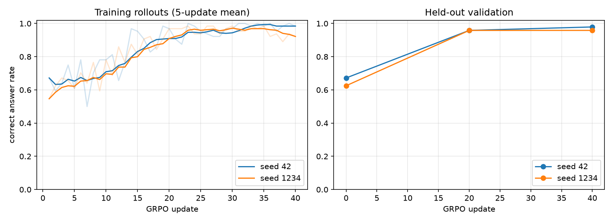
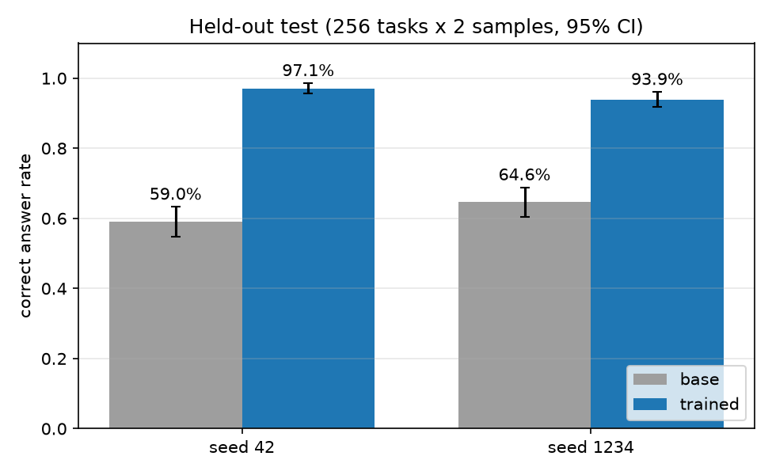
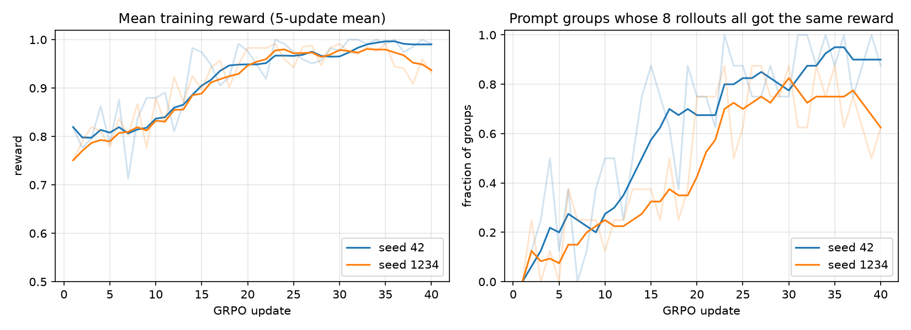
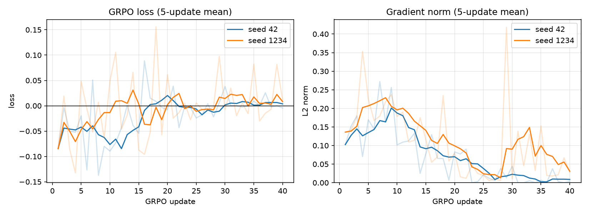

<!--
Copyright (c) Meta Platforms, Inc. and affiliates.
All rights reserved.

This source code is licensed under the BSD-style license found in the
LICENSE file in the root directory of this source tree.
-->

# Data analyst: RL post-training of Muse Glimmer with TRL

Teach Muse Glimmer to answer questions about CSV and log files with a `bash`
tool, using TRL's `GRPOTrainer` and a reward that checks the number the model
writes to `answer.json`. No labelled data, LLM judge or network access is
needed during training: every task and its answer are generated locally.

| | |
|---|---|
| Precision | BF16 frozen base, FP32 LoRA adapters |
| Model server | vLLM in server mode, tensor parallel 2 |
| Trainer | TRL `GRPOTrainer` with `environment_factory` multi-turn tool calling, one GPU |
| Hardware | 3x H100 95GB per run (two runs side by side on one 8x H100 node) |
| Offline? | Tasks and rewards are generated locally; setup downloads packages and weights. `WANDB_MODE=offline` logs without network |
| Max VRAM observed | Trainer 83.5 GiB, vLLM 90-93 GiB per GPU (preallocated) |
| Requires | `trl[vllm,peft]` |

The environment is the one from the [TitanRL data-analyst recipe](../../titanrl/data-analyst/):
a private workspace, one `bash` tool, an `answer.json` artifact and the same
tiered reward. The task files are harder, because the base model already
solves TitanRL's four templates under TRL's tool loop (99.4% on 128 validation
tasks x 4 samples).

## Results

Two independent seeds were each scored on the same 256 held-out test tasks (2
samples per task) before training and after 40 updates:

| | Base model | After 40 updates |
|---|---:|---:|
| Seed 42 | 59.0% | 97.1% |
| Seed 1234 | 64.6% | 93.9% |





The reward and loss curves show what GRPO optimized and why training levels off:





- **Reward:** the mean tiered reward of the training rollouts rises from about
  0.80 to about 0.97 by update 25 in both seeds and stays between 0.94 and 1.0
  afterwards.
- **Signal:** the right reward panel shows why it stops there. Once all eight
  rollouts of a prompt are correct, the group has no reward variance and gives
  no gradient. That covers about 60-95% of groups after update 25.
- **Loss:** GRPO's loss is a policy-gradient objective on group-centered
  advantages, so it stays near zero at every update instead of decreasing
  like a supervised loss. Its swings shrink as the reward saturates, and the
  gradient norm falls from about 0.2 around update 10 to 0.01-0.03 by update
  40, with a temporary rise in seed 1234 around update 30.

- **The base model fails by computing the wrong number, not by running out of
  budget.** Before training, at least 98.8% of test rollouts write a well-formed
  answer and at most 0.4% hit the token limit.
- **Training changes how it parses files.** In 128 sampled validation rollouts
  of the CSV task, the base model splits rows with `awk -F,` in 56% of them; the
  trained model (seed 1234) does so in 3% and reads the file with Python's `csv`
  module in all of them. On the access logs it stops relying on fixed
  whitespace-split field positions.
- **Validation accuracy rises from 67.2% / 62.5% to 95.8% by update 20** and
  stays there (97.9% / 95.8% at update 40).
- **Trade-off:** trained rollouts are longer (5.1-5.4 tool calls and about 1,400
  model tokens, versus 3.3-3.4 calls and about 800 tokens), and 3.1-3.5% of test
  rollouts hit the 4,096-token budget, mostly on the peak-minute task.

These are synthetic tasks from three templates. The result shows the recipe
works and fixes this failure pattern; it is not a general data-analysis
benchmark.

| Measurement (per run) | Value |
|---|---|
| GPUs | 3x H100 95GB: 2 for vLLM (tensor parallel 2), 1 for training |
| Update wall time | 352-371 s for 64 rollouts, including generation |
| Training throughput | 286-289 tokens/s: prompt, completion and tool tokens in training batches per second of update wall time |
| Generation speed | About 57 tokens/s per sequence (vLLM mean inter-token latency 17.6 ms); about 66-72k model tokens generated per update |
| Trainer GPU memory | 73-74 GiB PyTorch allocator peak; 83.5 GiB whole-device peak (nvidia-smi, sampled every 30 s) |
| vLLM GPU memory | 90-93 GiB per GPU, preallocated for weights and KV cache |
| End-to-end time | About 7 hours: 40 updates take about 4 hours; the base and trained test passes take about 40 and 65 minutes |

## Run it

### 1. Install

From this directory, in a fresh environment:

```bash
uv venv --python 3.12 glimmer-rl-trl-data-analyst
source glimmer-rl-trl-data-analyst/bin/activate
uv pip install "trl[vllm,peft]" wandb matplotlib pytest
pytest test_env.py
```

The CPU tests recompute every golden answer from the files the model sees and
check the reward tiers and the workspace isolation.

### 2. Start the vLLM server on two GPUs

```bash
CUDA_VISIBLE_DEVICES=0,1 VLLM_SERVER_DEV_MODE=1 vllm serve meta-models/Muse-Glimmer-30B \
  --tensor-parallel-size 2 --max-model-len 8192 \
  --weight-transfer-config '{"backend": "nccl"}' \
  --logprobs-mode processed_logprobs --max-logprobs -1
```

Wait for `Application startup complete`. Start a fresh server for every
training run.

### 3. Train on a third GPU

```bash
wandb login   # or: export WANDB_MODE=offline
CUDA_VISIBLE_DEVICES=2 VLLM_HOST_IP=127.0.0.1 python train.py --config config.yaml
```

The run scores the base model on the 256-task test split, trains for 40
updates with a validation check every 20 updates, saves the adapter to
`outputs/muse-glimmer-data-analyst`, and scores the trained adapter on the same
test split. Both test scores are written to `test_results.json`.

`VLLM_HOST_IP=127.0.0.1` keeps the trainer-to-server weight sync on the local
node. Without it, vLLM can pick an IPv6 address it cannot bind. To run a second
seed on the same node, start another server on two free GPUs with `--port 8001`
and add `--seed 1234 --vllm_server_port 8001 --vllm_group_port 51217` to the
training command.

### 4. Plot and evaluate

```bash
python plot.py outputs/muse-glimmer-data-analyst --out assets
CUDA_VISIBLE_DEVICES=2 VLLM_HOST_IP=127.0.0.1 python train.py --config config.yaml \
  --evaluate_only --adapter_path outputs/muse-glimmer-data-analyst
```

`plot.py` accepts several run directories to overlay seeds. `--evaluate_only`
without `--adapter_path` scores the base model.

## Files

| File | Purpose |
|---|---|
| `env.py` | Task generator, `bash` tool environment and reward |
| `train.py` | Builds `GRPOTrainer`, runs base and trained test evaluation |
| `config.yaml` | Every model, LoRA, rollout, optimizer and logging setting |
| `test_env.py` | CPU checks for tasks, reward and tool isolation |
| `plot.py` | Rebuilds the plots above from one or more run directories |
| `assets/` | Plots used in this README |

## How the task and reward work

Each rollout gets a private temporary workspace containing one input file and
a question whose answer is a single number. The model may call `bash` up to 12
times. TRL calls `reset` with the dataset row, exposes `bash` as the only tool,
masks tool output out of the loss, and scores the finished rollout with
`get_reward`.

| Template | File | What trips a naive one-liner |
|---|---|---|
| Category revenue | `orders.csv` | Product names contain quoted commas, so `awk -F,` reads the wrong columns |
| Peak error minute | Apache `access.log` | Timestamps must be cut at exactly the minute to bucket requests |
| Top 404 client | Combined-format `access.log` | Some request lines contain spaces, which shifts whitespace-split fields |

The reward is TitanRL's:

| Result | Reward |
|---|---|
| Correct number in `answer.json` | 1.0 |
| Well-formed answer, wrong number | 0.45 |
| Malformed `answer.json` | 0.20 |
| A command ran, but no answer file | 0.05 |
| Nothing | 0.0 |

Each repeat of an already-failed command subtracts 0.05 from a partial reward.
`accuracy` (correct number) and `answered` (well-formed file) are logged as
zero-weight rewards.

Train, validation and test tasks come from disjoint index ranges, so no test
file is ever seen in training.

## Training setup

| Setting | Value |
|---|---|
| Base model | `meta-models/Muse-Glimmer-30B`, BF16, frozen and not quantized |
| LoRA | Rank 16, alpha 32 (scale 2), dropout 0, no bias, FP32 adapter weights |
| LoRA targets | Every text-decoder layer: `q_proj`, `k_proj`, `v_proj`, `o_proj`, attention `gate_proj`, MLP `gate_proj`, `up_proj`, `down_proj` |
| Frozen | Vision tower, vision adapter and projection, embeddings, `lm_head` |
| Trainable parameters | 104,792,064 (0.35% of 29.8B) |
| Algorithm | TRL GRPO defaults: `loss_type="dapo"`, no KL term, group-normalized advantages, vLLM importance-sampling correction |
| Rollouts | 8 per prompt, temperature 1.0 without top-k/top-p filtering, `reasoning_strength: low`, up to 12 tool calls and 4,096 completion tokens (model and tool tokens) |
| Update | 8 prompts x 8 rollouts = 64 rollouts, learning rate 2e-5 after 5 warmup updates, 40 updates |

## Make it yours

- **Add templates:** write a function in `env.py` that returns the prompt, the
  file and the golden number, add it to `TEMPLATES`, and recompute its answer
  in `test_env.py`. Check the base model's accuracy first: tasks it already
  solves give GRPO no signal.
The `bash` tool strips credentials and redirects `HOME`/`TMPDIR` to the task
workspace, but it is not container isolation. Train on infrastructure without
secrets or unrelated writable data.

## Troubleshooting

| Symptom | Cause | Fix |
|---|---|---|
| Training hangs after `GET /get_world_size` | vLLM chose an IPv6 address for the weight-sync rendezvous | Set `VLLM_HOST_IP=127.0.0.1` for the trainer |
| `/update_weights` returns 500 or NCCL errors at startup | The server still holds an earlier trainer's weight-sync state | Restart the vLLM server before every run |
| `IndexError: list index out of range` in `_tool_call_loop` | Several trainer processes with server-mode vLLM and tools | Train with one process |
| CUDA out of memory during evaluation | TRL computes a loss for each evaluation batch | Keep `per_device_eval_batch_size: 16` |
| W&B `CommError` at the first update | No network path to the W&B server | `export WANDB_MODE=offline`, then `wandb sync` later |
| `TypeError: Data row contained incompatible types` | `log_completions` with multi-turn tool conversations | Leave `log_completions` off |

## Next steps

- [TitanRL data-analyst recipe](../../titanrl/data-analyst/): the original environment with full-parameter training.
- [Agentic fundamentals](../../../../agentic-fundamentals/): Muse Glimmer's tool-call format and agent loop.
- [SFT with Axolotl](../../../sft/axolotl/): when the model needs new knowledge or a new output format first.
