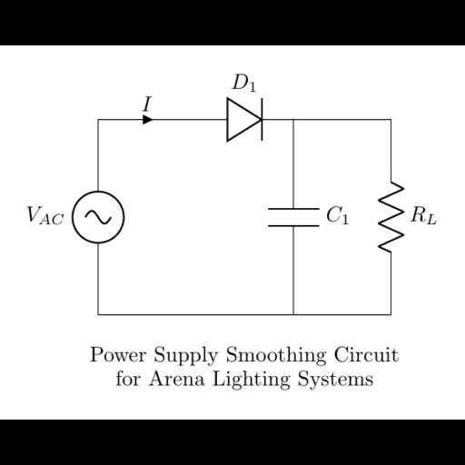
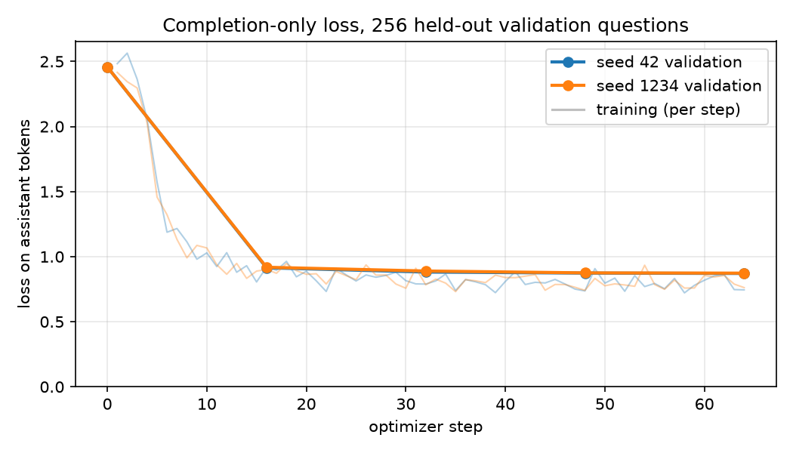
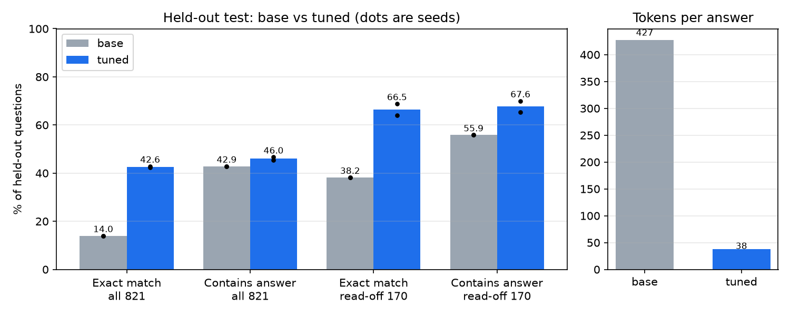

<!--
Copyright (c) Meta Platforms, Inc. and affiliates.
All rights reserved.

This source code is licensed under the BSD-style license found in the
LICENSE file in the root directory of this source tree.
-->

# Circuit-diagram QA: supervised fine-tuning of Muse Glimmer with TRL

Teach Muse Glimmer to answer circuit-diagram questions in a dataset's answer
format, using TRL's `SFTTrainer` with QLoRA on one 8x H100 node. The
data and use case are the same as in the [Axolotl SFT recipe](../axolotl/):
the `circuit` subset of CoSyn-400K. After one epoch over 2,048 examples (64
updates, under five minutes of training), held-out exact match rises from 14.0%
to 42.4-42.9% across two seeds, and answers shrink from 427 to 37-38 tokens
([Results](#results)).

## Recipe banner

| | |
|---|---|
| Precision | QLoRA: NF4 language model, BF16 vision modules, BF16 compute and LoRA adapters |
| Trainer | TRL `SFTTrainer`, data parallel over 8 processes with `accelerate` |
| Hardware | 8x H100 95GB, one node; one H100 also verified with a three-update run |
| Max VRAM observed | 27.2 GiB per GPU (whole device); 24.0 GiB PyTorch allocator peak |
| Model server | None |
| Offline? | Model and dataset download from the Hugging Face Hub; `WANDB_MODE=offline` logs without network |
| Requires | `trl[peft,vlm,quantization]` (TRL 1.18 or newer, Transformers 5.18 or newer), `wandb` |

## Quickstart

Run these from this directory.

### 1. Install

In a fresh environment:

```bash
uv venv --python 3.12 glimmer-sft-trl
source glimmer-sft-trl/bin/activate
uv pip install "trl[peft,vlm,quantization]" wandb matplotlib pytest
pytest test_data.py
```

The bracketed names are TRL's optional extras: `peft` adds PEFT for the LoRA
adapters, `vlm` adds `torchvision` and Pillow for the Muse Glimmer image
processor, and `quantization` adds bitsandbytes for the 4-bit base model. The
quotes keep the shell from reading the brackets as a file pattern.

The CPU tests check the data order and splits, the rendered prompt, which
tokens carry loss, and the answer scoring. They download the processor files,
not the model weights.

### 2. Train and evaluate on 8 GPUs

```bash
wandb login   # or: export WANDB_MODE=offline
accelerate launch --num_processes 8 train.py --config config.yaml
```

The run scores the base model on all 821 held-out test questions, trains for
one epoch (64 updates) with a validation loss every 16 updates, saves the
adapter to `outputs/muse-glimmer-cosyn-qlora`, and scores the adapter on the
same questions. Both scores, the differences with confidence intervals, and the
throughput and memory measurements are written to `test_results.json`. It takes
about 17 minutes; 11 of them go to loading the model and scoring the base
model, which reasons before it answers.

On one GPU, keep the global batch of 32 with more accumulation steps. Training
then takes about 31 minutes instead of 5, and both test passes run on that one
GPU, so consider a smaller `--test_size` first:

```bash
CUDA_VISIBLE_DEVICES=0 python train.py --config config.yaml --gradient_accumulation_steps 32
```

For a second seed, add `--seed 1234 --output_dir outputs/seed1234 --run_name seed1234`.

### 3. Plot and re-score

```bash
python plot.py outputs/muse-glimmer-cosyn-qlora --out assets
accelerate launch --num_processes 8 train.py --config config.yaml \
  --evaluate_only --adapter_path outputs/muse-glimmer-cosyn-qlora
```

`plot.py` accepts several run directories to overlay seeds. `--evaluate_only`
scores the saved adapter again and writes `test_results_adapter.json`; without
`--adapter_path` it scores the base model into `test_results_base.json`. A
re-scored seed 42 adapter reproduced all 821 generations of the training run
exactly.

## Files

| File | Purpose |
|---|---|
| `data.py` | Loads CoSyn circuit, builds the prompt and conversations, scores answers |
| `train.py` | Builds `SFTTrainer` with QLoRA, scores the base model and the adapter on the test split |
| `config.yaml` | Every model, LoRA, data, optimizer and logging setting |
| `test_data.py` | CPU checks for data, prompt rendering, the loss mask and scoring |
| `plot.py` | Rebuilds the plots in [Results](#results) from one or more run directories |
| `assets/` | Plots and the example diagram used in this README |

The plots in `assets/` are generated by `plot.py` and are covered by this
repository's license. `assets/example.png` is a validation image from
[CoSyn-400K](https://huggingface.co/datasets/allenai/CoSyn-400K) by the Allen
Institute for AI, licensed under ODC-BY-1.0, letterboxed to 512x512. The
training data is downloaded from the Hub at run time and is not stored here.

## What just happened

**Data.** Each CoSyn circuit image is a rendered diagram with six or seven
questions on average. `data.py` makes one example per question, with the dataset's
explanation followed by `Answer: <short answer>` as the target, and letterboxes
every image to 512x512. As in the Axolotl recipe, training uses the first 2,048
questions in diagram-ID order (313 diagrams) and the validation loss uses the
first 256 validation questions. The test set is all 821 questions about the 128
validation diagrams, none of which appear in training.

**Prompt.** Every training and test example starts with the same system
message:

```text
You answer questions about circuit diagrams. Explain briefly, then give the final answer on its own last line as "Answer: <short answer>".

Reasoning strength: low.
```

The first sentence tells the base model the expected answer format, so the
before-and-after comparison measures more than formatting. Naming the
reasoning strength in the system message also replaces the chat template's
default system block, which would add today's date and set the reasoning
strength to high. TRL's vision collator does not pass `chat_template_kwargs`,
so the system message is the way to set it for training.

**Loss.** With `assistant_only_loss: true`, TRL renders each example with its
bundled Muse Glimmer training template and computes the loss only on the
assistant message: ` to=user<|message|>`, the target text and `<|eot|>`. The
system prompt, the question and the image tokens carry no loss. Sequences are
446-527 tokens; the recipe neither truncates nor packs them.

**QLoRA.** The language model is loaded in NF4. The vision tower, vision
adapter, projection and `lm_head` stay in BF16 and frozen. LoRA adapters are
added to the attention and MLP projections of the language model only; the
vision tower reuses the names `q_proj`, `k_proj` and `v_proj`, so the target is
a regular expression rather than a list of names. Freezing the vision encoder
is this recipe's choice, not a TRL limitation: TRL trains whatever the LoRA
targets make trainable (see [Make it yours](#make-it-yours)).

**Test pass.** Greedy decoding with up to 1,024 new tokens, sharded across the
8 processes. The scorer reads only the message addressed to the user, never the
private `to=self` reasoning, and takes the text after its last `Answer:` line.
A response cut off at 1,024 tokens scores zero.

### Example: one test question before and after training



*What component is responsible for smoothing the voltage?* The reference
answer is `C1`.

**Base model, 147 tokens, wrong by exact match.** It reasons privately first,
then gives the right component in a longer answer:

```text
[to=self]  Diagram shows VAC source, D1 diode, C1 capacitor in parallel with RL.
           D1 is in series. So smoothing is capacitor C1. Possibly also diode? ...
           Answer: C1 (the capacitor)  Probably just capacitor.
[to=user]  The circuit is a half-wave rectifier with a filter capacitor. The
           capacitor charges on the conducting half-cycle and supplies current to
           the load between peaks, reducing ripple.

           Answer: C1, the filter capacitor (in parallel with R_L)
```

**Trained model (both seeds), 35 tokens, correct.**

```text
[to=user]  The capacitor labeled C1 is responsible for smoothing the voltage by
           storing and releasing energy, which helps to reduce fluctuations in the
           output voltage.

           Answer: C1
```

## Results

| 821 held-out test questions | Base model | Seed 42 | Seed 1234 |
|---|---:|---:|---:|
| Exact match | 14.0% | 42.9% | 42.4% |
| Answer F1 | 28.4% | 56.2% | 55.5% |
| Contains answer | 42.9% | 46.7% | 45.3% |
| Read-off exact match (170 questions) | 38.2% | 68.8% | 64.1% |
| Read-off contains answer (170 questions) | 55.9% | 70.0% | 65.3% |
| Responses cut off at 1,024 tokens | 49 | 0 | 0 |
| Tokens per answer | 427 | 37 | 38 |

- **Exact match:** the text after the last `Answer:` line equals the reference
  after normalization (lowercase, no punctuation or articles, number words as
  digits).
- **Answer F1:** word-overlap F1 between those two.
- **Contains answer:** every reference word appears in the answer, however long
  it is. It ignores phrasing.
- **Read-off:** questions whose reference has at most three words and contains
  a digit or an underscore: counts, values and component labels such as `V_in`
  or `C1`.

The base model is deterministic here: both seeds produced identical base
generations for all 821 questions. Rerunning seed 42 with the files in this
directory reproduced every training loss, validation loss and test generation
of the published run.





- **Exact match improves by 28.9 and 28.4 points** (95% confidence intervals
  25.7-32.0 and 25.5-31.4, resampling whole diagrams). Per seed, 242-246
  questions flip from wrong to right and 9 from right to wrong.
- **Most of that gain is answer style.** The base model's short answers average
  13.2 words against 2.3 for the references; the trained model's average 2.1.
  Ignoring phrasing, the share of answers that contain the reference rises only
  from 42.9% to 46.7% and 45.3% (+3.8 points, interval 0.0-7.5; +2.4 points,
  interval -1.0 to 5.9).
- **The content gain is in what the diagram states.** On read-off questions,
  contains answer rises by 14.1 and 9.4 points (intervals 6.4-21.8 and
  1.8-16.6). Part of it is notation the dataset uses, such as `V_in` rather
  than `Vin`, and naming a component's label when no value is drawn.
- **The trained model answers directly.** The targets contain no private
  reasoning, so the trained model stops reasoning: answers are 11 times
  shorter and none reaches the token limit. That is faster, but the model no
  longer deliberates. Of the 9 right-to-wrong flips per seed, 3 and 6 are
  counting questions that the base model got right by counting step by step.
- **Validation loss falls from 2.46 to 0.87 by update 64** in both seeds and is
  nearly flat after update 32 (0.88 and 0.89 there). The Axolotl recipe's QLoRA
  run, with the same data, LoRA and optimizer settings, ended at 0.8655; it
  starts higher (2.94) with prompts that do not state the answer format.

CoSyn's questions and answers were generated by a language model. These scores
measure agreement with those references, and some of them, especially counts,
are debatable. Fine-tuning teaches the model the references' conventions along
with their content.

| Measurement (per run) | Value |
|---|---|
| GPUs | 8x H100 95GB, data parallel, one process each |
| Training time | 252-257 s for 64 updates, plus 21 s for five validation passes |
| Training throughput | 3,760-3,820 tokens/s in total, 470-478 per GPU: every token in the training batches (image, prompt and answer; batch size 1, so no padding) per second of training time, validation excluded |
| GPU memory | 24.0 GiB PyTorch allocator peak (25.1 GiB reserved); 27.2 GiB whole-device peak from `nvidia-smi`, sampled every 2 s |
| One GPU | 29 s per update (521 tokens/s), so 64 updates take about 31 minutes; 22.8 GiB allocator peak, 25.4 GiB whole-device peak (three-update run with 32 accumulation steps) |
| End-to-end time | About 17 minutes: about 11 to load and score the base model, 5 to train, 1 to score the adapter |

W&B records the training and validation loss, learning rate, gradient norm,
token accuracy and token count per update, and the test metrics under `test/`.

## Training setup

| Setting | Value |
|---|---|
| Base model | `meta-models/Muse-Glimmer-30B`; language model in NF4 with double quantization, vision modules and `lm_head` in BF16 |
| LoRA | Rank 32, alpha 16 (scale 0.5), dropout 0.05, no bias, BF16 adapter weights (TRL's QLoRA default) |
| LoRA targets | `q_proj`, `k_proj`, `v_proj`, `o_proj`, `gate_proj`, `up_proj`, `down_proj` in all 52 language-model layers |
| Frozen | Vision tower, vision adapter and projection, attention gate projection, embeddings, `lm_head` |
| Trainable parameters | 191,692,800 (0.64% of 30.0B) |
| Loss | Cross-entropy on the assistant message and its `<\|eot\|>` (`assistant_only_loss`) |
| Data | 2,048 questions about 313 diagrams, one epoch, no packing, images letterboxed to 512x512 |
| Optimizer | 8-bit AdamW (bitsandbytes), learning rate 2e-4 with cosine decay after 7 warmup updates, no weight decay |
| Batch | 32 per update: 8 GPUs x 1 example x 4 accumulation steps, 64 updates |
| Test decoding | Greedy, up to 1,024 new tokens, same system prompt as training |

The LoRA, optimizer, batch and data settings match the Axolotl recipe's QLoRA
configuration.

## Make it yours

- **Use your own data:** return `{"images": [...], "messages": [...]}` rows like
  `data.to_conversation`, with every message's content as a list of typed parts
  (`{"type": "text", ...}` or `{"type": "image"}`). Keep one system prompt for
  training and evaluation, and write a scorer for your answers in `data.score`.
- **Decide about reasoning:** the targets here contain no private reasoning, so
  the trained model answers without it. Check your hardest questions before
  making the same choice.
- **Train the vision encoder too:** TRL does not freeze any part of the model
  itself; the LoRA targets decide what trains. To add adapters to the vision
  tower, vision adapter and projection, extend the target pattern:

  ```bash
  accelerate launch --num_processes 8 train.py --config config.yaml \
    --lora_target_modules 'model\.(language_model\.layers\.\d+\.(self_attn\.(q|k|v|o)_proj|mlp\.(gate|up|down)_proj)|vision_tower\.layers\.\d+\.(attn\.(q_proj|k_proj|v_proj|proj)|mlp\.fc[12])|vision_adapter\.fc[12]|vision_projection)'
  ```

  In three-update checks on one and on eight H100s, this raised the trainable
  parameters from 191.7M to 245.9M (53.2M of them in the vision tower), and
  every vision adapter received updates. On one GPU the whole-device peak rose
  from 25.4 to 25.9 GiB. Its quality was not measured. Updating the vision
  encoder on a small or narrow dataset can hurt general image understanding,
  so evaluate it on ordinary image prompts as well as on your task.
- **Use more data:** this slice is 2,048 of CoSyn circuit's 67,939 training
  questions. Validation loss is nearly flat after update 32, so try new
  questions before more epochs over the same ones.
- **Shorter checks:** lower `test_size` for a quicker before-and-after
  comparison; the base model's test pass is most of the run time.

## Troubleshooting

| Symptom | Cause | Fix |
|---|---|---|
| `Could not load any image processor class` | The Muse Glimmer image processor needs `torchvision` | Install TRL's `vlm` extra: `uv pip install "trl[vlm]"` |
| `ArrowInvalid: cannot mix list and non-list` | Some message contents are strings and others are lists | Use a list of typed parts for every message |
| The rendered prompt contains `Current date` or `Reasoning strength: high.` | No system message; TRL's vision collator does not pass `chat_template_kwargs` | Name the reasoning strength in the system message, as `data.py` does |
| Many base answers cut off | The base model reasons privately before answering | Raise `max_new_tokens`; cut-off answers score zero |
| A reloaded adapter scores slightly differently | PEFT upcasts the BF16 adapter to FP32 on load | Load it with `autocast_adapter_dtype=False`, as `train.py --evaluate_only` does |
| `Assistant-only loss for vision datasets requires transformers>=5.18` | Older Transformers | Upgrade Transformers |
| W&B `CommError` | No network path to the W&B server | `export WANDB_MODE=offline`, then `wandb sync` later |
| CUDA out of memory in a test pass | Generation batch too large for the GPU | Lower `generation_batch_size` |

## Next steps

- [SFT with Axolotl](../axolotl/): the same data with bf16 LoRA and full-parameter FSDP2, plus text-only and multi-image data.
- [Post-training overview](../../): when to use SFT and when to use RL.
- [Agentic fundamentals](../../../agentic-fundamentals/): Muse Glimmer's message channels, including `to=self` and `to=user`.
