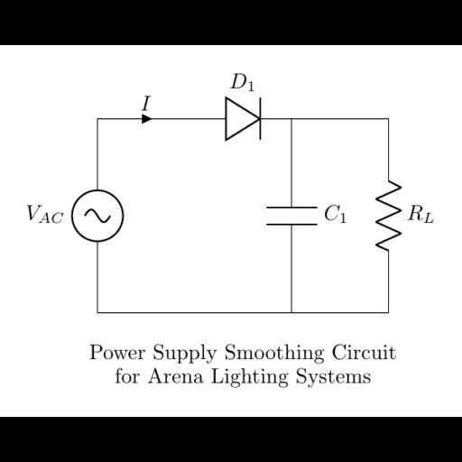
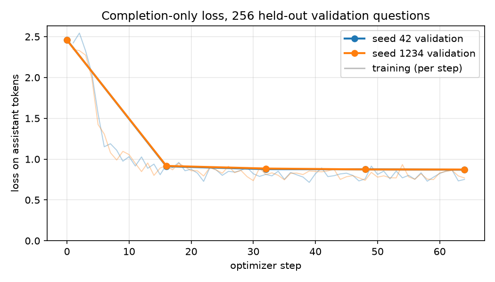
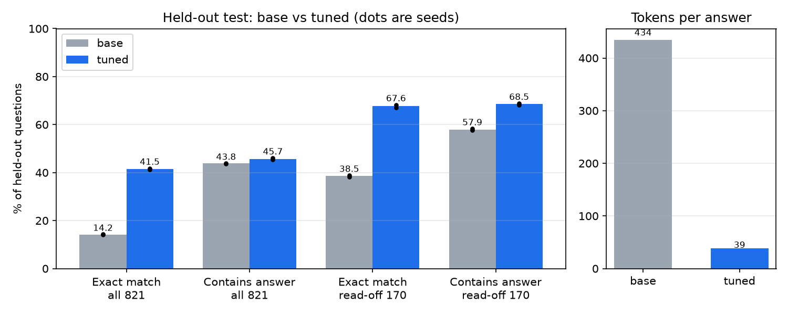

<!--
Copyright (c) Meta Platforms, Inc. and affiliates.
All rights reserved.

This source code is licensed under the BSD-style license found in the
LICENSE file in the root directory of this source tree.
-->

# Circuit-diagram QA: supervised fine-tuning of Muse Glimmer with Unsloth

Teach Muse Glimmer to answer circuit-diagram questions in a dataset's answer
format on one GPU, using Unsloth for QLoRA and TRL's `SFTTrainer` for the
training loop. The data and use case are the same as in the [TRL](../trl/)
and [Axolotl](../axolotl/) SFT recipes: the `circuit` subset of CoSyn-400K. After
one epoch over 2,048 examples (64 updates, about 16 minutes of training on one
H100), held-out exact match rises from 14% to 41.2-41.8% across two seeds, and
answers shrink from about 430 to 38-39 tokens ([Results](#results)).

## Recipe banner

| | |
|---|---|
| Precision | QLoRA: NF4 language model, BF16 vision modules and compute, FP32 LoRA adapters |
| Trainer | Unsloth `FastModel` and `UnslothVisionDataCollator` with TRL `SFTTrainer`, one process |
| Hardware | One H100 95GB; a 22 GiB memory cap also checked with a four-update run ([Make it yours](#make-it-yours)) |
| Max VRAM observed | Training: 23.2 GiB PyTorch allocator peak, 24.5 GiB whole device. Whole run: 34.7 GiB whole device, while scoring 64 test questions at a time |
| Model server | None |
| Offline? | Model and dataset download from the Hugging Face Hub; `WANDB_MODE=offline` logs without network |
| Requires | `unsloth` (which installs TRL, Transformers, PEFT and bitsandbytes), `wandb` |

## Quickstart

Run these from this directory.

### 1. Install

In a fresh environment:

```bash
uv venv --python 3.12 glimmer-sft-unsloth
source glimmer-sft-unsloth/bin/activate
uv pip install unsloth wandb matplotlib pytest
pytest test_data.py
```

Unsloth chooses the TRL and Transformers versions it supports, which can be
older than the latest releases, so keep this environment separate from other
training stacks. The tests check the data order and splits, the rendered
prompt, which tokens carry loss, and the answer scoring. They download the
processor and config files, not the model weights, and need no GPU.

### 2. Train and evaluate on one GPU

```bash
wandb login   # or: export WANDB_MODE=offline
python train.py --config config.yaml
```

The run scores the base model on all 821 held-out test questions, trains for
one epoch (64 updates) with a validation loss every 16 updates, saves the
adapter with the processor and chat template to
`outputs/muse-glimmer-cosyn-unsloth`, and scores the adapter on the same
questions. Both scores, the differences with confidence intervals, and the
throughput and memory measurements are written to `test_results.json`. It takes
about 75 minutes on one H100: about 42 to load the model and score the base
model, which reasons before it answers, 26 to train and 5 to score the adapter.
For a quicker check, add `--test_size 128`.

For a second seed, add `--seed 1234 --output_dir outputs/seed1234 --run_name seed1234`.

### 3. Plot and re-score

```bash
python plot.py outputs/muse-glimmer-cosyn-unsloth --out assets
python train.py --config config.yaml \
  --evaluate_only --adapter_path outputs/muse-glimmer-cosyn-unsloth
```

`plot.py` accepts several run directories to overlay seeds. `--evaluate_only`
scores the saved adapter again and writes `test_results_adapter.json`; without
`--adapter_path` it scores the base model into `test_results_base.json`.

## Files

| File | Purpose |
|---|---|
| `data.py` | Loads CoSyn circuit, builds the prompt and conversations, scores answers |
| `train.py` | Loads the model with Unsloth, trains with `SFTTrainer`, scores the base model and the adapter |
| `config.yaml` | Every model, LoRA, data, optimizer and logging setting |
| `test_data.py` | CPU checks for data, prompt rendering, the loss mask and scoring |
| `plot.py` | Rebuilds the plots in [Results](#results) from one or more run directories |
| `assets/` | Plots and the example diagram used in this README |

The plots in `assets/` are generated by `plot.py` and are covered by this
repository's license. `assets/example.png` is a validation image from
[CoSyn-400K](https://huggingface.co/datasets/allenai/CoSyn-400K) by the Allen
Institute for AI, licensed under ODC-BY-1.0, letterboxed to 512x512. The
training data is downloaded from the Hub at run time and is not stored here.

## What just happened

**Model.** Unsloth's `FastModel` loads
[`unsloth/Muse-Glimmer-30B-unsloth-bnb-4bit`](https://huggingface.co/unsloth/Muse-Glimmer-30B-unsloth-bnb-4bit),
an upload of `meta-models/Muse-Glimmer-30B` with the language model in NF4
(double quantization, BF16 compute) and the vision modules, embeddings and
`lm_head` in BF16: the NF4 settings the TRL recipe applies at load time, in a
22 GB download instead of 60 GB. The processor and
chat template come from `meta-models/Muse-Glimmer-30B` (`tokenizer_name` in
`config.yaml`): the template in Unsloth's upload adds `Reasoning strength:
high.` even when the system message sets it. `train.py` saves this processor
next to the adapter, so loading the adapter directory with `FastModel` uses the
same template.

**Data.** Each CoSyn circuit image is a rendered diagram with six or seven
questions on average. `data.py` makes one example per question, with the
dataset's explanation followed by `Answer: <short answer>` as the target, and
letterboxes every image to 512x512. As in the Axolotl recipe, training uses the
first 2,048 questions in diagram-ID order (313 diagrams) and the validation loss
uses the first 256 validation questions. The test set is all 821 questions about
the 128 validation diagrams, none of which appear in training.

**Prompt.** Every training and test example starts with the same system
message as in the TRL recipe:

```text
You answer questions about circuit diagrams. Explain briefly, then give the final answer on its own last line as "Answer: <short answer>".

Reasoning strength: low.
```

The first sentence tells the base model the expected answer format, so the
before-and-after comparison measures more than formatting. Naming the reasoning
strength in the system message also replaces the chat template's default system
block, which would add today's date and set the reasoning strength to high.

**Loss.** `UnslothVisionDataCollator` renders each conversation, expands the
image placeholder into image tokens and, with `train_on_responses_only`, keeps
the loss only on the text after `<|start|>assistant`: the recipient
` to=user<|message|>`, the target and `<|eot|>`, the same tokens the TRL
recipe trains with `assistant_only_loss`. The system prompt, the question and
the image tokens carry no loss. The recipient matters: a test
prompt ends at `<|start|>assistant`, so the model must learn to address the
user. Unsloth's notebook starts the loss after `to=user<|message|>` and appends
that recipient to every inference prompt; without it, a model trained that way
wrote all 821 test answers to its private `to=self` channel. `resize="max"`
keeps the letterboxed images as they are. Sequences are 446-527 tokens; nothing
is truncated or packed. Each example's loss is the mean over its answer tokens,
and an update averages 32 examples.

**QLoRA.** `FastModel.get_peft_model` adds LoRA adapters to the attention
projections (`q_proj`, `k_proj`, `v_proj`, `o_proj` and the attention output
gate `gate_proj`) and the MLP projections of all 52 language-model layers.
`finetune_vision_layers: false` keeps the vision encoder frozen. Unsloth keeps
the adapters in FP32 and offloads checkpointed activations to CPU memory. LoRA
dropout is 0, the setting Unsloth's fast LoRA path is built for.

**Test pass.** Greedy decoding with up to 1,024 new tokens in batches of 64.
The scorer reads only the message addressed to the user, never the private
`to=self` reasoning, and takes the text after its last `Answer:` line. A
response cut off at 1,024 tokens scores zero.

### Example: one test question before and after training



*What component is responsible for smoothing the voltage?* The reference
answer is `C1`.

**Base model, 143 tokens, wrong by exact match.** It reasons privately first,
then gives the right component in a longer answer:

```text
[to=self]  Diagram shows VAC source, D1 diode, C1 capacitor in parallel with RL.
           So smoothing is capacitor C1. Possibly also diode is rectifier. ...
           Answer: C1 (the capacitor)  Probably just capacitor.
[to=user]  The circuit is a half-wave rectifier with a filter capacitor across the
           load. The capacitor charges on the conduction peaks and supplies
           current to $R_L$ between peaks, reducing ripple.

           Answer: C1, the filter/smoothing capacitor
```

**Trained model (both seeds), 35 tokens, correct.**

```text
[to=user]  The capacitor labeled C1 is responsible for smoothing the voltage by
           storing and releasing energy, which helps to reduce fluctuations in the
           output voltage.

           Answer: C1
```

## Results

| 821 held-out test questions | Seed 42: base | Seed 42: tuned | Seed 1234: base | Seed 1234: tuned |
|---|---:|---:|---:|---:|
| Exact match | 14.3% | 41.2% | 14.1% | 41.8% |
| Answer F1 | 29.1% | 55.1% | 28.9% | 56.0% |
| Contains answer | 43.7% | 45.3% | 43.8% | 46.0% |
| Read-off exact match (170 questions) | 38.2% | 68.2% | 38.8% | 67.1% |
| Read-off contains answer (170 questions) | 57.6% | 68.8% | 58.2% | 68.2% |
| Responses cut off at 1,024 tokens | 46 | 0 | 48 | 0 |
| Tokens per answer | 431 | 38 | 438 | 39 |

- **Exact match:** the text after the last `Answer:` line equals the reference
  after normalization (lowercase, no punctuation or articles, number words as
  digits).
- **Answer F1:** word-overlap F1 between those two.
- **Contains answer:** every reference word appears in the answer, however long
  it is. It ignores phrasing.
- **Read-off:** questions whose reference has at most three words and contains
  a digit or an underscore: counts, values and component labels such as `V_in`
  or `C1`.

Each run scores the base model itself, because greedy decoding in this
software stack is not bit-for-bit repeatable (see
[Troubleshooting](#troubleshooting)). Across three runs the base model scored
14.1-14.4% exact match.





- **Exact match improves by 26.9 and 27.6 points** (95% confidence intervals
  23.7-30.2 and 24.7-30.7, resampling whole diagrams). Per seed, 233 and 237
  questions flip from wrong to right, and 12 and 10 from right to wrong.
- **Most of that gain is answer style.** The base model's short answers average
  14.0 words against 2.3 for the references; the trained model's average 2.2
  and 2.1.
  Ignoring phrasing, the share of answers that contain the reference rises only
  from 43.7% to 45.3% and from 43.8% to 46.0% (+1.6 points, interval -2.0 to
  5.2; +2.2 points, interval -1.3 to 5.7).
- **The content gain is in what the diagram states.** On read-off questions,
  contains answer rises by 11.2 and 10.0 points (intervals 3.6-18.4 and
  2.5-17.4). Part of it is the dataset's notation: 9 of the 31 and 29
  read-off questions gained are labels written with an underscore, such as
  `V_in`, and others are units without a space, such as `120V`, or a
  component's label given when no value is drawn.
- **The trained model answers directly.** The targets contain no private
  reasoning, so the trained model stops reasoning: answers are 11 times shorter
  and none reaches the token limit. That is faster, but the model no longer
  deliberates. Of the right-to-wrong flips, 5 and 8 are counting questions.
- **Validation loss falls from 2.46 to 0.870 and 0.873 by update 64** and is
  nearly flat after update 32 (0.878 and 0.885 there). The TRL recipe, with
  the same data and prompt on eight GPUs, ended at 0.871 and 0.873, and its
  adapters scored 42.9% and 42.4% exact match. The Axolotl recipe's QLoRA run
  ended at 0.8655; its prompts do not state the answer format.
- **Run-to-run differences are about a point.** A second seed-42 run reached
  42.3% exact match and 0.869 validation loss. Re-scoring the saved seed-42
  adapter with `--evaluate_only` gave 42.4% (41.2% in the training run), with
  749 of 821 short answers identical.

CoSyn's questions and answers were generated by a language model. These scores
measure agreement with those references, and some of them, especially counts,
are debatable. Fine-tuning teaches the model the references' conventions along
with their content.

| Measurement (per run) | Value |
|---|---|
| GPU | One H100 95GB, one process |
| Training time | 943 and 934 s for 64 updates (14.6-14.7 s per update, including a first update of about a minute that compiles the model), plus 3.6-4.2 minutes for five validation passes |
| Training throughput | 1,020-1,030 tokens/s: every token in the training batches (image, prompt and answer; one example per micro-batch, so no padding), 964,011 in total, per second of training time, validation excluded |
| GPU memory | Training: 23.2 GiB PyTorch allocator peak, 23.6 GiB reserved, 24.5 GiB whole-device peak from `nvidia-smi` (sampled every second). Test passes in batches of 64: 32.6 GiB (base model) and 34.7 GiB (adapter) whole-device peak |
| End-to-end time | About 75 minutes: about 42 to load the model and score the base model, 26 to train and save, 5 to score the adapter |

W&B records the training and validation loss, learning rate and gradient norm
per update, and the test metrics under `test/`.

## Training setup

| Setting | Value |
|---|---|
| Base model | `unsloth/Muse-Glimmer-30B-unsloth-bnb-4bit`: language model in NF4 with double quantization; vision modules, embeddings and `lm_head` in BF16 |
| Processor and chat template | `meta-models/Muse-Glimmer-30B` |
| LoRA | Rank 32, alpha 16 (scale 0.5), dropout 0, no bias, FP32 adapter weights |
| LoRA targets | `q_proj`, `k_proj`, `v_proj`, `o_proj`, attention `gate_proj`, MLP `gate_proj`, `up_proj`, `down_proj` in all 52 language-model layers |
| Frozen | Vision tower, vision adapter and projection, embeddings, `lm_head` |
| Trainable parameters | 209,584,128 (0.70% of 30.0B) |
| Loss | Cross-entropy on the recipient ` to=user<\|message\|>`, the target and `<\|eot\|>` (`train_on_responses_only`), averaged per example |
| Data | 2,048 questions about 313 diagrams, one epoch, no packing, images letterboxed to 512x512 |
| Optimizer | 8-bit AdamW (bitsandbytes), learning rate 2e-4 with cosine decay after 7 warmup updates, no weight decay |
| Batch | 32 per update: 1 example x 32 accumulation steps, 64 updates |
| Test decoding | Greedy, up to 1,024 new tokens, same system prompt as training |

The data, prompt, test set, scorer, LoRA rank and alpha, learning rate,
schedule, optimizer and global batch match the TRL recipe. This recipe differs
in LoRA dropout (0 instead of 0.05), in also adapting the attention output
gate, in FP32 instead of BF16 adapters, and in averaging the loss per example
instead of per token.

## Make it yours

- **Use your own data:** return `{"images": [...], "messages": [...]}` rows like
  `data.to_conversation`, with every message's content as a list of typed parts
  (`{"type": "text", ...}` or `{"type": "image"}`). Keep one system prompt for
  training and evaluation, and write a scorer for your answers in `data.score`.
  Keep `max_length` above your longest example: the collator would truncate
  longer rows, cutting image tokens or the answer, so `train.py` stops before
  training if any row reaches it.
- **Decide about reasoning:** the targets here contain no private reasoning, so
  the trained model answers without it. Check your hardest questions before
  making the same choice.
- **Train the vision encoder too:** add `--finetune_vision_layers true`. In a
  three-update check this added LoRA to the attention and MLP projections of
  the vision tower, raised the trainable parameters from 209.6M to 262.8M (53.2M
  in the vision tower), and every vision adapter received updates. Its quality
  was not measured. Updating the vision encoder on a small or narrow dataset can
  hurt general image understanding, so evaluate it on ordinary image prompts as
  well as on your task.
- **Smaller GPUs:** Unsloth moves the input embeddings to CPU memory when the GPU
  is short of memory. With PyTorch's allocator capped at 22 GiB on an H100, a
  four-update run with smaller test batches completed (20.7 GiB allocated, 21.9
  GiB reserved, about 20 s per update in that short run):

  ```bash
  PYTORCH_CUDA_ALLOC_CONF=expandable_segments:True \
    python train.py --config config.yaml --generation_batch_size 8
  ```

  Without `expandable_segments` the same run ran out of memory at the first
  optimizer step. This emulates a 24 GB GPU; it was not run on one.
- **Use more data:** this slice is 2,048 of CoSyn circuit's 67,939 training
  questions. Validation loss is nearly flat after update 32, so try new
  questions before more epochs over the same ones.

## Troubleshooting

| Symptom | Cause | Fix |
|---|---|---|
| The rendered prompt contains `Reasoning strength: high.` after the system message | The chat template from Unsloth's upload | Load the processor from `meta-models/Muse-Glimmer-30B` (`tokenizer_name`) |
| The rendered prompt contains `Current date` | No system message | Start every conversation with a system message, as `data.py` does |
| `Unsloth: xformers is installed but cannot load` | The xformers wheel does not match the installed PyTorch | Harmless: PyTorch attention is used |
| `num_items_in_batch could not be counted` | Unsloth notice for this model class | Harmless: each example's loss is averaged first |
| The trained model answers in the `to=self` channel and scores zero | The loss starts after `to=user<\|message\|>`, so the recipient is never trained | Start it at `<\|start\|>assistant`, as `RESPONSE_PART` in `train.py` does |
| Many base answers cut off | The base model reasons privately before answering | Raise `max_new_tokens`; cut-off answers score zero |
| `examples reach max_length`, or `Mismatch in image token count` | An example is longer than `max_length`, and the collator would truncate it | Raise `max_length` |
| CUDA out of memory in a test pass | Generation batch too large for the GPU | Lower `generation_batch_size` |
| A re-scored adapter gives slightly different generations | Greedy decoding in this software stack is not bit-for-bit repeatable, with or without Unsloth | Compare scores, not individual generations |
| W&B `CommError` | No network path to the W&B server | `export WANDB_MODE=offline`, then `wandb sync` later |

## Next steps

- [SFT with TRL](../trl/): the same task with TRL's own QLoRA path across eight GPUs.
- [SFT with Axolotl](../axolotl/): the same data with bf16 LoRA and full-parameter FSDP2, plus text-only and multi-image data.
- [Unsloth's Muse Glimmer guide](https://unsloth.ai/docs/models/muse-glimmer/train): notebooks, reinforcement learning and export.
- [Post-training overview](../../): when to use SFT and when to use RL.
- [Agentic fundamentals](../../../agentic-fundamentals/): Muse Glimmer's message channels, including `to=self` and `to=user`.
